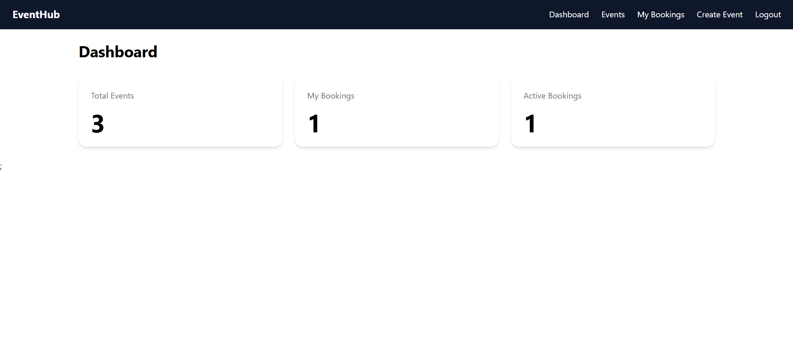
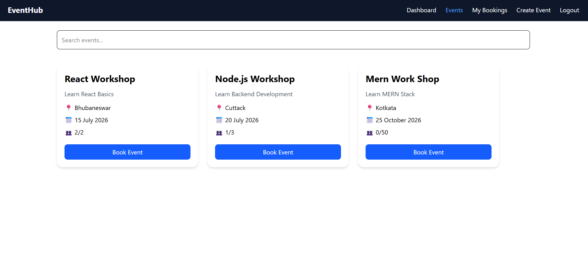
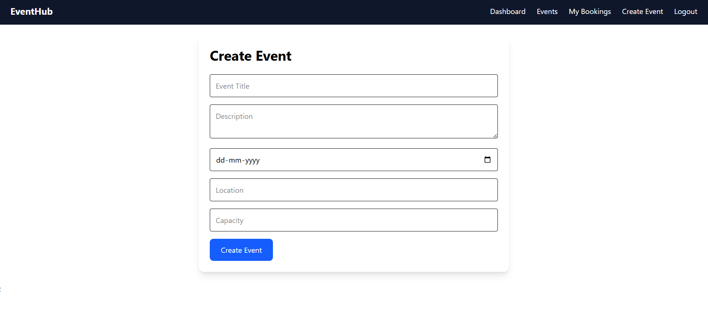
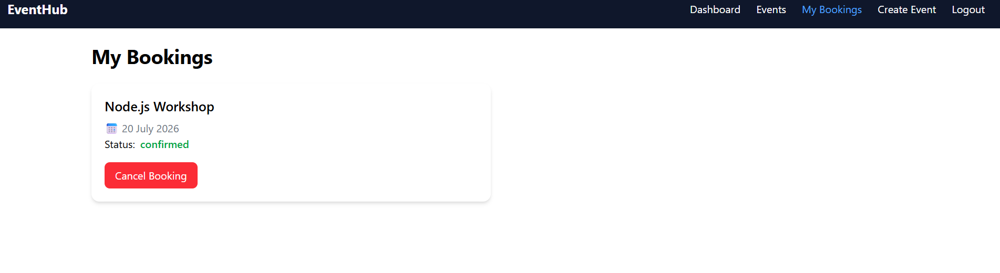
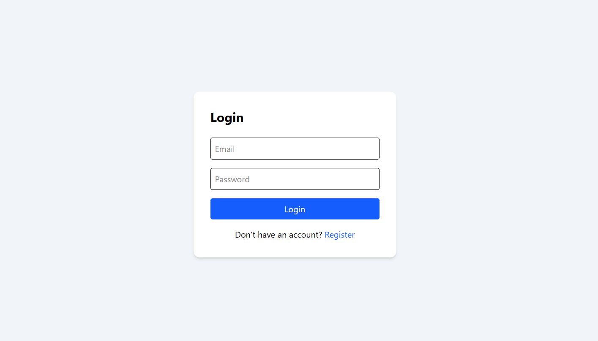

# 🎟️ Event Management System

A full-stack web application built using the MERN stack that allows users to discover events, manage bookings, and track their booking status. The application also supports event creation and booking cancellation.

## 📸 Application Screenshots

### 1. Events Dashboard
Browse available events, search for events, and check seat availability.



### 2. Event Details
View detailed information about an individual event before booking.



### 3. Create Event
Create events by providing details such as title, description, date, location, and capacity.



### 4. My Bookings
View your bookings, check booking statuses, and cancel bookings when permitted.



### 5. Authentication
Register an account or log in to access the application.



---

## ✨ Features

- **User Authentication:** Register and log in to access the application.
- **Event Management:** Create events with titles, descriptions, dates, locations, and capacity.
- **Event Discovery:** Browse available events and search for relevant events.
- **Event Details:** View individual event information before booking.
- **Booking Management:** Book events and view personal bookings.
- **Capacity Management:** Check event capacity and prevent bookings when an event is full.
- **Booking Cancellation:** Cancel existing bookings and update their status.
- **Booking Status Tracking:** View booking statuses such as confirmed and cancelled.
- **Responsive Interface:** Access the application through a user-friendly interface.

*Note: Keep only the features that are implemented and working in your current version.*

## 🛠️ Tech Stack

### Frontend
- React.js
- JavaScript
- HTML5
- CSS3
- Axios (if used for API requests)
- React Router (if used for navigation)

### Backend
- Node.js
- Express.js
- REST APIs
- JWT authentication (if implemented)
- bcryptjs (if used for password hashing)

### Database
- MongoDB
- Mongoose

### Development Tools
- Git and GitHub
- Postman
- Visual Studio Code
- npm

## 🏗️ Project Structure

The following is an illustrative structure. Adjust it to match your actual repository.

```text
Event-Management-System/
├── client/
│   ├── public/
│   ├── src/
│   └── package.json
├── server/
│   ├── controllers/
│   ├── models/
│   ├── routes/
│   ├── middleware/
│   ├── server.js
│   └── package.json
├── screenshots/
│   ├── dashboard.png
│   ├── event-details.png
│   ├── create-event.png
│   ├── my-bookings.png
│   └── authentication.png
├── README.md
├── LICENSE
└── .gitignore
```

## ⚙️ Getting Started

Follow these steps to run the project locally.

### Prerequisites

Install the following:

- Node.js and npm
- MongoDB or a MongoDB Atlas account
- Git

### 1. Clone the Repository

```bash
git clone https://github.com/Satyajit799/Event-Management-System.git
```

Navigate into the project directory:

```bash
cd Event-Management-System
```

### 2. Install Dependencies

Install the frontend and backend dependencies separately, according to your repository structure.

For example, if your frontend is inside `client` and your backend is inside `server`:

```bash
cd server
npm install
```

Then install the frontend dependencies:

```bash
cd ../client
npm install
```

### 3. Configure Environment Variables

Create a `.env` file in the backend directory.

Example:

```env
PORT=5000
MONGO_URI=your_mongodb_connection_string
JWT_SECRET=your_jwt_secret
```

Replace the example values with your actual configuration.

The variable names and port must match those referenced in your backend code. Do not commit real credentials, database passwords, or JWT secrets to GitHub.

### 4. Start the Backend

From the backend directory, run the command configured in your `package.json`.

For example:

```bash
npm run dev
```

If your project uses a different script, use the appropriate command.

### 5. Start the Frontend

Open another terminal and navigate to the frontend directory.

```bash
npm run dev
```

Open the local URL displayed in the terminal to access the application.

## 🔄 Application Workflow

1. Register a new account or log in.
2. Browse the available events.
3. Select an event to view its details.
4. Book an event if seats are available.
5. View your booking in the My Bookings section.
6. Cancel a booking if cancellation is supported and permitted.
7. Create new events using the event creation form, if your account has permission.

## 🧠 Key Implementation Concepts

This project demonstrates practical full-stack development concepts, including:

- Building a React frontend that communicates with a REST API.
- Creating backend routes and controllers using Express.js.
- Designing database models with Mongoose.
- Implementing user authentication and protected routes, if configured.
- Managing event capacity during booking.
- Handling booking cancellation and status updates.
- Connecting frontend components to backend endpoints.
- Testing API functionality during development.

## 🧪 Testing

API endpoints can be tested using Postman.

Recommended test cases include:

- User registration and login.
- Retrieving the list of events.
- Creating an event with valid data.
- Booking an event with available seats.
- Attempting to book an event when its capacity is reached.
- Retrieving a user's bookings.
- Cancelling a booking and checking the updated status.

## 🚀 Future Improvements

Potential enhancements include:

- Online payment integration.
- QR-code-based booking verification.
- Email notifications for bookings.
- Event filtering by category and date.
- Pagination for large event lists.
- Automated backend and frontend tests.
- Role-based access control for event organizers and administrators.

These are proposed improvements and should not be considered implemented features unless they are already available in the application.

## 🔐 Security Notes

- Keep environment variables and credentials out of version control.
- Validate incoming data on the backend.
- Protect private routes with appropriate authentication and authorization.
- Store passwords securely using a suitable password-hashing algorithm.
- Check authorization before allowing users to modify or cancel bookings.

## 📄 License

This project is licensed under the [MIT License](LICENSE).

Copyright (c) 2026 Satyajit Mohanty

## 👨‍💻 Author

**Satyajit Mohanty**

GitHub: [@Satyajit799](https://github.com/Satyajit799)
